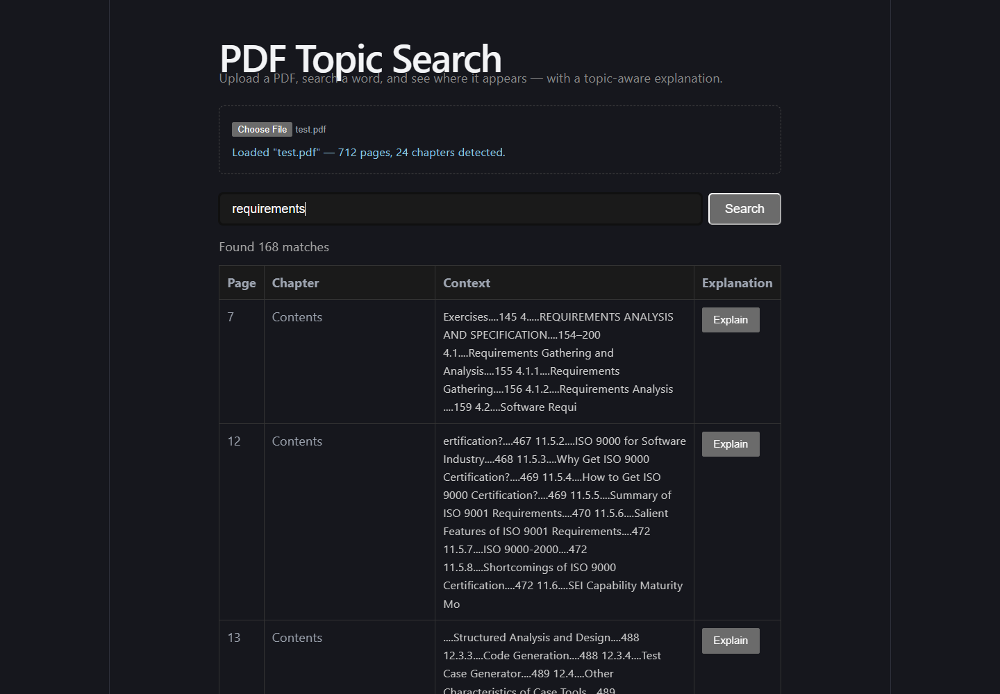
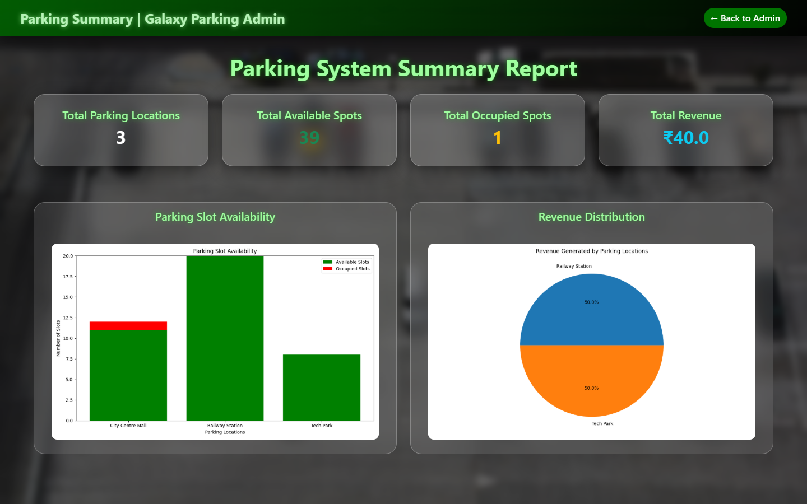
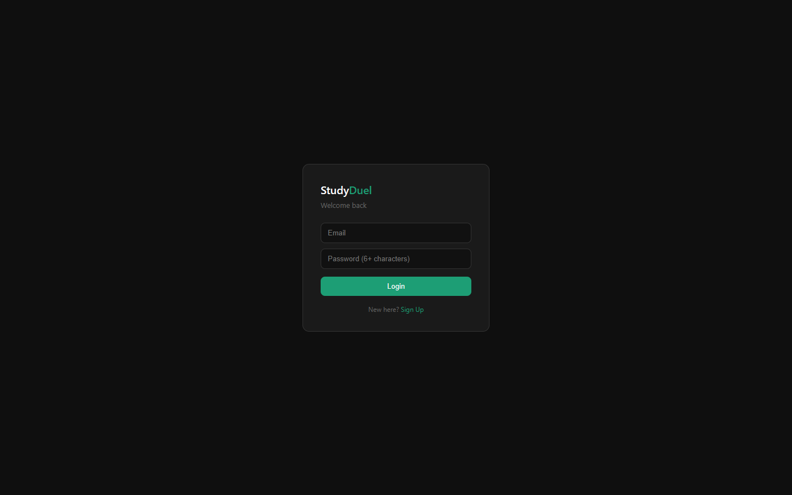
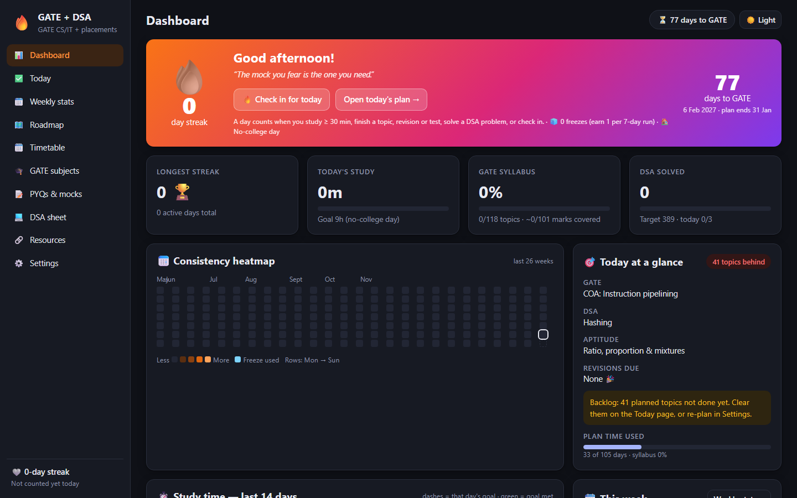

 

 

---

## ⚡ Right Now

- 🏛️ **AI/ML & Full-Stack Intern** at IIT Roorkee — Built Environment Lab, Google Centre for Climate Technology
- 🌐 **WebOps Developer** at Saranda House, IIT Madras BS — building and maintaining the house website
- 🎓 Pursuing dual degree: **B.Tech CSE** (MJPRU) + **BS Data Science** (IIT Madras)
- 🧠 Exploring **RAG pipelines**, **LLM-based document extraction**, and **Explainable AI**

---

## 🏆 Highlights

| 🎯 GATE Qualified | 🌏 GCI World 2026 | 🏗️ IIT Roorkee Intern | ☁️ 98 Cloud Badges |
|:---:|:---:|:---:|:---:|
| CS/IT in 3rd year | U-Tokyo, Matsuo Lab | Full-stack + AI/ML | Google Cloud, Silver League |

- 🏅 **Certificate of Appreciation** — IIT Madras BS, for WebOps contributions to Saranda House
- 🏅 **Certificate of Excellence** — Sundarbans House, IITM BS
- 💻 **Women Who Master Hackathon** — Logitech x Aspire For Her
- 🧪 **GCI World 2026** — Selected for data science programme, Matsuo-Iwasawa Lab, University of Tokyo

---

## 👩‍💻 About Me

- 🎓 Dual-degree student: **B.Tech in Computer Science & IT** (MJPRU, CGPA: 8.15) and **BS in Data Science & Applications** (IIT Madras)
- 🏗️ Completed **AI/ML & Full-Stack internship at IIT Roorkee** — worked on GMAP, a Material Passport platform (Next.js 15, React 19, MongoDB, Vertex AI)
- 🌐 **WebOps Developer** at Saranda House, IIT Madras BS — house website with Next.js and Sanity CMS
- 🏆 **GATE CS/IT 2026 qualified** in third year of B.Tech
- 🛠️ I build full-stack web apps: from Flask and Firebase backends to React and Next.js frontends
- 🤖 Exploring ML (XGBoost, SHAP, scikit-learn), LLM APIs (Gemini, Groq) and RAG pipelines

---

## 🧰 Tech Stack

**Languages**

**Frontend**

**Backend & Databases**

**Tools & Cloud**

---

## 🚀 Featured Projects

<table>
<tr>
<td width="50%" valign="top">

### 🛍️ [ShopAI](https://github.com/HIRA04IRSHAD/ShoppingPro)

Smart shopping assistant: type *"4k tv under 50000"* or *"sasta phone"* and it finds, ranks and scores the deals. The same Python code runs in Flask and in the browser with Pyodide.

`Python` `Flask` `JavaScript` `Pyodide`

</td>
<td width="50%" valign="top">

### 📄 [SmartSearch PDF](https://github.com/HIRA04IRSHAD/smartsearch-pdf)

Search a word in any PDF and see the page, chapter and context of every match, with one-click Gemini explanations of what the word means there.

`Flask` `PyMuPDF` `React` `Gemini API`

</td>
</tr>
<tr>
<td width="50%" valign="top">

### 🚗 [Galaxy Parking](https://github.com/HIRA04IRSHAD/vehicle-parking-app)

Parking lot management with admin and user roles, hourly billing and revenue charts. IIT Madras MAD-1 project, secured with CSRF protection and role checks.

`Flask` `SQLAlchemy` `Bootstrap` `Matplotlib`

</td>
<td width="50%" valign="top">

### ⚔️ [StudyDuel](https://github.com/HIRA04IRSHAD/studyduel)

Two-player study tracker for GATE and DSA prep: shared tasks, DSA and GATE progress, schedules and a head-to-head battle view, synced in real time.

`React` `Vite` `Firebase Auth` `Realtime DB`

</td>
</tr>
<tr>
<td width="50%" valign="top">

### 🔥 [GATE + DSA Tracker](https://github.com/HIRA04IRSHAD/gate-dsa-tracker)

Offline study dashboard for GATE CS/IT and placements: streaks, heatmap, day-by-day plan, mock tests and a 250+ problem DSA sheet.

`JavaScript` `HTML` `CSS` `localStorage`

</td>
<td width="50%" valign="top">

### 🎨 [Drawing Canvas](https://github.com/HIRA04IRSHAD/interactive-canvas-app)

Browser drawing app on the HTML5 Canvas API: brush, eraser, shapes, colour picker and image export.

`JavaScript` `HTML5 Canvas` `CSS`

</td>
</tr>
</table>

---

## 🤝 Open Source & Team Work

**[Saranda House website](https://saranda.iitmbs.org)** · IIT Madras BS
Developer on the WebOps team: I build and maintain the house website with Next.js and Sanity CMS, with merged pull requests to the codebase and ongoing work directly in Sanity. Received a **Certificate of Appreciation** from the IIT Madras BS programme.

---

## 📊 GitHub Stats

  

---

## 🏅 Certifications & Badges

---

---

**Let's connect!** I'm always happy to talk about web development, AI/ML and new projects.

